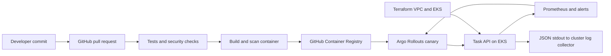

# Architecture and request lifecycle

## App endpoints

- `GET /` describes the service.
- `GET /health` is a liveness check.
- `GET /ready` is a readiness check.
- `GET /tasks`, `POST /tasks`, `GET /tasks/<id>`, and `DELETE /tasks/<id>` demonstrate a tiny task API.
- `GET /metrics` exposes request and uptime counters in Prometheus text format.

The API is deliberately small and stores tasks in process memory to keep the code approachable. Each pod has its own task list; this is not shared or durable storage.
